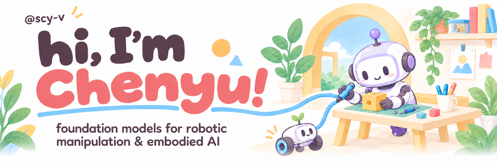

 

Hi! 👋 I'm **Chenyu Su**, a third-year Ph.D. student at the University of Science and Technology of China (**[USTC](https://en.ustc.edu.cn/)**), advised by Prof. **[Weiwei Shang](http://staff.ustc.edu.cn/~wwshang/)**.

My research focuses on **foundation models for robotics**, with the goal of enabling **reliable and generalizable manipulation in the real world**. I'm currently interested in:

- **Spatial Intelligence & Embodied Agents.** Leveraging foundation model priors for spatial reasoning and robotic manipulation, and building embodied agents for autonomous task execution.
- **Foundation Model Post-Training & Continual Learning:** Advancing foundation models through real-world reinforcement learning and experience-driven closed-loop policy optimization.
- **Foundation Models for Robotic Manipulation:** Researching and developing foundation models for robotic manipulation, from large-scale data collection and pre-training to post-training and real-world deployment.

Feel free to reach out at **[suchenyu@mail.ustc.edu.cn](mailto:suchenyu@mail.ustc.edu.cn)** if you're interested in my work or research collaboration! 😊
